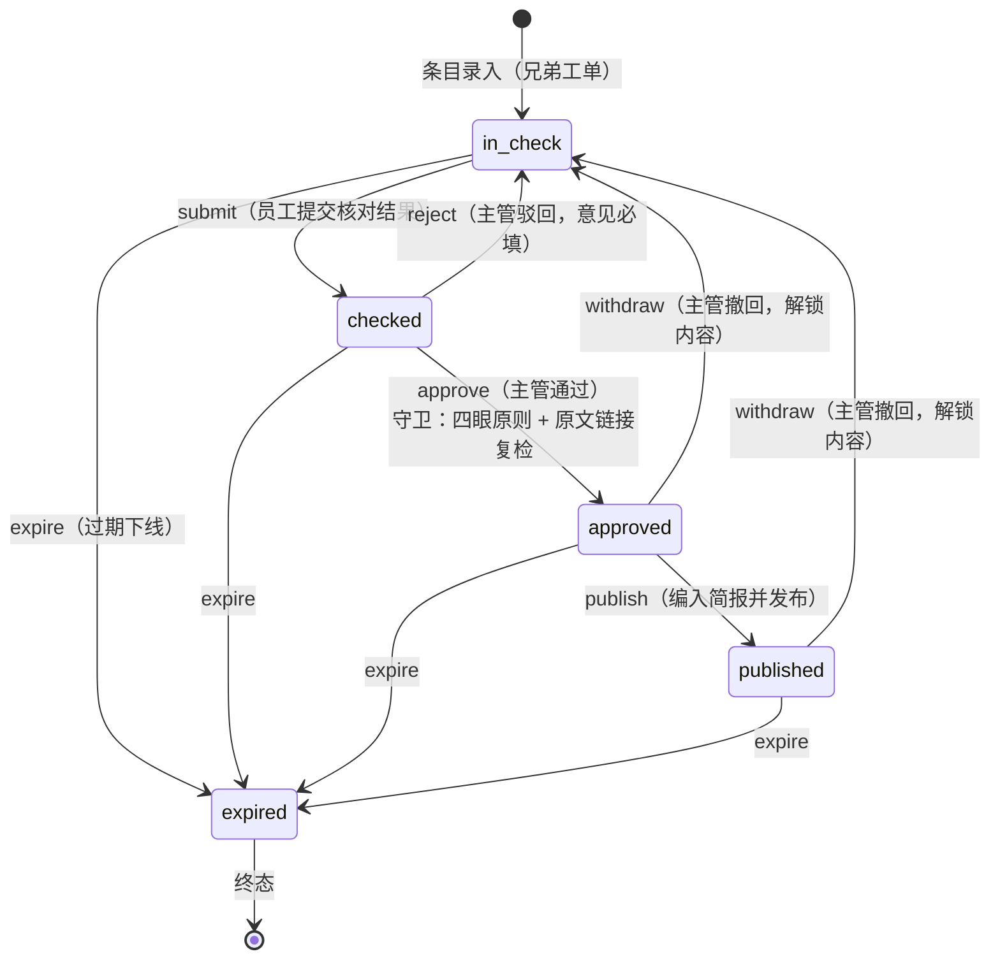
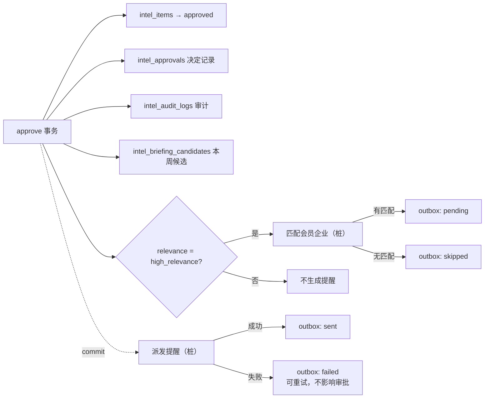

# 情报条目状态机与审批流（S5-INTEL-027）

本文件是状态流转的唯一口径，与 `app/state_machine.py` 的 `TRANSITIONS` 表一一对应；
`tests/test_state_machine_matrix.py` 用全矩阵断言二者一致。

## 1. 状态流转图

`expired` 为终态：任何动作（含再次 expire）都返回 409。
除上图之外的任意 (状态, 动作) 组合一律 **409 illegal_transition**。

## 2. 流转表

| 动作 | 触发端点 | 允许的源状态 | 目标状态 | 角色 | 守卫/副作用 |
|---|---|---|---|---|---|
| submit | `POST /api/intel/items/{id}/submit` | in_check | checked | 员工或主管 | 记录 `checked_by`/`checked_at`；写审计 |
| approve | `POST /api/intel/items/{id}/approve` | checked | approved | 仅主管 | 四眼原则（403）→ 链接复检（失败 409）；写 `intel_approvals` + 审计；加入本周简报候选；high_relevance 匹配生成当日提醒 outbox |
| reject | `POST /api/intel/items/{id}/reject` | checked | in_check | 仅主管 | 意见必填（缺失/空白 422）；意见保留在条目 `review_comment` 与 `intel_approvals`；写审计 |
| publish | `POST /api/intel/items/{id}/publish` | approved | published | 仅主管 | 记录 `published_at`；写审计 |
| withdraw | `POST /api/intel/items/{id}/withdraw` | approved, published | in_check | 仅主管 | 清空审批/发布时间戳；软删全部在库简报候选；跳过未发提醒；写 `intel_approvals`(withdraw) + 审计 |
| expire | `POST /api/intel/items/{id}/expire` | in_check, checked, approved, published | expired | 仅主管 | 记录 `expired_at`；软删候选、跳过未发提醒；写审计 |

内容编辑（`PATCH /api/intel/items/{id}`，字段 title/summary/match_conditions/relevance）：

| 当前状态 | 行为 |
|---|---|
| in_check | 允许编辑，状态不变 |
| checked | 允许编辑，但**自动回落 in_check**（内容变更必须重新核对，设计判断见 README §4） |
| approved / published | **409 content_locked**（工单规则：approved 后摘要与条件锁定） |
| expired | 409 content_locked（终态不可编辑） |

## 3. approve 守卫顺序

1. 角色：非主管 → **403 forbidden_role**
2. 数据范围：跨 org / 越 site / 软删 / 不存在 → **404 not_found**
3. 状态：非 checked → **409 illegal_transition**（AC-1）
4. 四眼原则：`approver == checked_by` → **403 four_eyes_violation**（AC-2）
5. 原文链接复检：失败 → **409 link_recheck_failed**，条目保持 checked，写 `approve_blocked` 审计

顺序保证：非法状态永远先答 409；四眼拦截不消耗复检调用；复检只对合法审批执行。

## 4. 审批通过后的两件事（同事务落库，提交后派发）

- `week_start` = 审批当日（`APP_TIMEZONE`）所在 ISO 周的周一；部分唯一索引保证同周同条目只有一条在库候选。
- 提醒失败不回滚审批；`python -m app.jobs.retry_reminders` 重试 failed 行（默认最多 5 次尝试）。
- 撤回/过期会软删在库候选并把 pending 提醒置为 skipped。